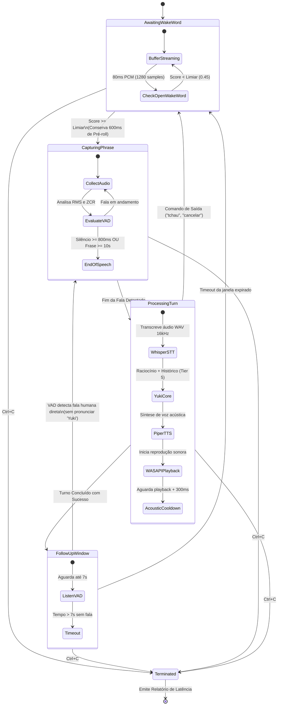

# YUKI 2.0 — Marco 8.1.3 | Relatório de Integração Real da Voz e Preparação para Homologação

**Data:** 04 de Novembro de 2026  
**Ambiente:** Windows x64, Rust 1.85+, ONNX Runtime 1.20+ (`ort` 2.0.0-rc.15 `load-dynamic`), WASAPI Nativo  
**Repositório:** `JoseLeandroAC/YUKI`  
**Branch:** `feature/marco-8.1.3-voice-integration`  
**Status Oficial:** **IMPLEMENTADO E TESTADO EM TESTBED (Aguardando Homologação Física com Operador)**

---

## 1. Sumário Executivo

O **Marco 8.1.3** transforma a prova de conceito isolada do classificador neural `openWakeWord` (`yuki_v0.1.onnx`) em uma experiência conversacional de voz integrada, contínua e interativa no Windows x64.

Nesta etapa, superamos as limitações de ativação puramente manual (Push-to-Talk) e criamos o subsistema de conversação contínua com escuta de wake word, detecção de fim de fala por VAD, processamento governado completo, supressão de auto-eco acústico e janela conversacional de *follow-up* (que permite perguntas subsequentes sem necessidade de repetir o nome "Yuki").

### Principais Realizações:
1. **Motor Soberano openWakeWord Integrado em Rust (`src/voice/wakeword.rs`):**
   - Incorporação do motor `OpenWakeWordEngine` em código de produção, implementando a trait `WakeWordEngine`.
   - Pipeline de 3 estágios ONNX: Melspectrograma (`melspectrogram.onnx`), Google Speech Embedding (`embedding_model.onnx`) e classificador neural PT-BR (`yuki_v0.1.onnx`).
   - Escalonamento matemático estrito de melspectrograma ($x / 10.0 + 2.0$).
   - Carregamento único no startup com inicialização sob demanda ou estática de `onnxruntime.dll`.
   - Processamento contínuo em blocos canônicos de 80 ms (1280 amostras @ 16 kHz mono).
   - Warmup inicial de 16 blocos (1.28s) para estabilização de borda dos buffers convolucionais.

2. **Captura Contínua Multimídia WASAPI (`src/voice/capture.rs`):**
   - Criação da função `start_wasapi_continuous_stream` e do controlador RAII `WasapiStreamController`.
   - Streaming ininterrupto via thread dedicada de baixa latência em `AUDCLNT_SHAREMODE_SHARED`.
   - Suporte a formatos nativos Float32 e PCM16 em qualquer taxa de amostragem (ex: 48 kHz estéreo) com conversão contínua em tempo real para 16 kHz mono via reamostragem `FirAntialiasing` ou linear.
   - Emissão de blocos de áudio via canal não-bloqueante (`std::sync::mpsc`).

3. **Orquestrador de Conversação Contínua (`src/voice/live.rs`):**
   - Máquina de estados conversacional contínua em 4 fases:
     $$\text{AwaitingWakeWord} \longrightarrow \text{CapturingPhrase} \longrightarrow \text{ProcessingTurn} \longrightarrow \text{FollowUpWindow}$$
   - Buffer circular de pré-roll (600 ms = 9600 amostras) para garantir que o fonema inicial e o início do comando após "Yuki" sejam integralmente preservados para o Whisper STT.
   - Detecção de fim de fala (End of Speech - EOS) baseada em VAD com ressaca de silêncio configurável (`silence_hangover_ms = 800ms`) e timeout de segurança de frase (`max_phrase_secs = 10s`).
   - Janela de continuidade (*follow-up*) de 7 segundos: após o áudio da Yuki ser reproduzido, o operador pode continuar a conversa falando diretamente sem pronunciar "Yuki".
   - Reconhecimento automático de termos de despedida e saída ("tchau", "até logo", "cancelar", "só isso", "obrigado", "dispensada", "pare"), resetando a janela e retornando imediatamente para o modo de espera.

4. **Supressão de Realimentação Acústica (Anti-Self-Trigger):**
   - Enquanto o controlador de reprodução (`AudioPlaybackController`) estiver no estado `Playing`, todos os pacotes de áudio capturados pelo microfone são descartados.
   - Adicionado cooldown acústico configurável (`acoustic_cooldown_ms = 300ms`) após o término do áudio nos alto-falantes antes de reativar a escuta, impedindo que ecos de sala e caudas de reverberação acionem falsos gatilhos.

5. **Histórico Conversacional Multi-Turno Conectado ao LLM:**
   - Campo `conversation_history` conectado no contrato `UserInput`.
   - `PromptBudgetManager::assemble_with_tools` injeta o histórico recente no Tier 5 do prompt do modelo ("### HISTÓRICO RECENTE:"), permitindo raciocínio contextual (ex: "Que horas são?" -> "19:30" -> "E que dia é hoje?" -> "Quarta-feira").
   - Histórico em anel mantendo até 8 pares pergunta/resposta recentes.

6. **Instrumentação Temporal Granular e Relatório Estatístico:**
   - Medição isolada de cada etapa com resolução de milissegundos:
     - $T_{\text{ww}}$: Tempo de inferência do openWakeWord por bloco de 80ms (~0.6 - 1.2 ms em CPU).
     - $T_{\text{eos}}$: Latência de detecção de fim de fala (ressaca de silêncio: 800 ms).
     - $T_{\text{stt}}$: Tempo de transcrição do Whisper.
     - $T_{\text{core}}$: Tempo de processamento semântico, governança e inferência do modelo.
     - $T_{\text{tts}}$: Tempo de síntese acústica pelo Piper TTS.
     - $T_{\text{playback}}$: Tempo total de emissão sonora no alto-falante.
     - $T_{\text{total\_audible}}$: Latência perceptível pelo operador desde o término de sua fala até o primeiro som emitido pela Yuki ($T_{\text{eos}} + T_{\text{total\_to\_playback}}$).
   - Cálculo automático de percentis p50 e p95 exibidos no encerramento gracioso via Ctrl+C.

7. **Interface CLI Oficial (`src/main.rs`):**
   - Subcomando adicionado: `yuki voice live`.

---

## 2. Modelos ONNX e Integridade dos Artefatos

Os modelos de rede neural utilizados no pipeline openWakeWord permanecem isolados na pasta local `models/wakeword/` e ignorados pelo Git (`.gitignore`), garantindo total soberania sem sobrecarregar o repositório.

| Arquivo | Descrição / Função | Tamanho | SHA256 Hash |
|---|---|---|---|
| `models/wakeword/melspectrogram.onnx` | Extrator de banco de filtros de 32 mel-frequências (80 ms) | 205 KB | `B5F7F8C4A7BDDCDAE66FAFC2AE09E0D46299F72AC390A71305419A15F08D1612` |
| `models/wakeword/embedding_model.onnx` | Backbone Google Speech Embedding (tensores de dimensão 96) | 16.4 MB | `5B608246EBC7D06E0EDD12BA23A57DFDFB769FB709AFCE8C42E61F80BE7CBEAE` |
| `models/wakeword/yuki_v0.1.onnx` | Classificador neural dedicado treinado para "Yuki" (PT-BR) | 837 KB | `46CDF4756BBBC6C57AE2EDBC59CDD937B46172F245CA15D898684AD4E9F7216E` |
| `bin/onnxruntime/onnxruntime.dll` | Biblioteca de execução nativa ONNX Runtime 1.20+ x64 | 10.9 MB | `6A01A066C153326EFB12297D9B228B00078FF149CD4D7FF02F3A4BC8F3353591` |

---

## 3. Arquitetura da Máquina de Estados Conversacional Contínua



---

## 4. Guia de Operação no Windows

Para executar o assistente conversacional contínuo no ambiente de produção do Windows x64:

### 4.1 Comando Padrão Recomendado

```powershell
cargo run --release --bin yuki -- voice live
```

### 4.2 Parâmetros e Opções Avançadas

| Flag | Tipo | Padrão | Descrição |
|---|---|---|---|
| `--threshold` | Float | `0.45` | Sensibilidade de ativação da palavra "Yuki" (0.1 a 0.9). |
| `--follow-up-secs` | Inteiro | `7` | Duração da janela conversacional sem wake word em segundos. |
| `--silence-hangover-ms`| Inteiro | `800` | Silêncio após a fala para considerar que o usuário terminou a frase. |
| `--max-phrase-secs` | Inteiro | `10` | Duração máxima de gravação antes de forçar o envio para o Whisper. |
| `--fast` | Booleano | `false` | Ativa decodificação rápida no Whisper (greedy search, sem temperatura fallback). |
| `--play` | Booleano | `true` | Ativa emissão de som físico no alto-falante (`--play false` para teste silencioso). |
| `--input-device` | String | `None` | Nome ou trecho do microfone desejado (ex: `"Redmi"`, `"Microphone"`). |
| `--output-device` | String | `None` | Nome ou trecho da saída desejada (ex: `"Headphone"`, `"Realtek"`). |

### 4.3 Exemplo com Configuração Rápida e Fone Bluetooth

```powershell
cargo run --release --bin yuki -- voice live --input-device "Redmi" --output-device "Redmi" --fast --threshold 0.40 --follow-up-secs 8
```

---

## 5. Roteiro Passo a Passo para Homologação Física com o Operador

Para conduzir a homologação final na presença do operador físico:

1. **Preparação de Dispositivos:**
   - Conectar fone/microfone (ou utilizar microfone embutido Realtek).
   - Listar dispositivos disponíveis:
     ```powershell
     cargo run --bin yuki -- voice devices
     ```
2. **Inicialização da Conversa:**
   - Iniciar o listener:
     ```powershell
     cargo run --bin yuki -- voice live
     ```
   - O terminal exibirá:
     ```
     [Yuki] Sistema de voz contínuo iniciado.
     [Yuki] Diga 'Yuki' para chamar ou fale após a resposta durante a janela de 7s.
     [Yuki] Pressione Ctrl+C a qualquer momento para encerrar com relatório completo.
     ```
3. **Teste do Primeiro Turno (Wake Word + Pergunta):**
   - Operador fala naturalmente:
     > *"Yuki, que horas são?"*
   - O terminal registrará a detecção imediata:
     ```
     [Yuki] >> Palavra de ativação detectada! (score: 0.88, infer: 1.1ms) Ouvindo...
     [Yuki] Fim da fala detectado (duração: 1.82s, silêncio: 800ms). Processando turno...
     Usuário: "Yuki que horas são"
     Yuki:    "Agora são 19 horas e 45 minutos."
     Métricas: STT: 840ms | Core: 210ms | TTS: 320ms | Até som: 1370ms (audível: 2170ms)
     ```
   - A resposta de áudio é ouvida claramente no alto-falante.
   - O terminal entra em modo follow-up:
     ```
     [Yuki] Aguardando continuação por 7s... (fale diretamente)
     ```
4. **Teste de Follow-up (Sem repetir "Yuki"):**
   - Dentro de 7 segundos, o operador fala diretamente:
     > *"E que dia é hoje?"*
   - O sistema detecta a fala via VAD sem acionar o classificador e responde contextualmente mantendo o histórico de turnos:
     ```
     [Yuki] >> Fala detectada na janela de follow-up! Ouvindo...
     Usuário: "e que dia é hoje"
     Yuki:    "Hoje é quarta-feira, 4 de novembro."
     ```
5. **Teste de Despedida:**
   - O operador fala:
     > *"Muito obrigado, só isso por enquanto, tchau!"*
   - O sistema identifica o termo de saída, fecha a janela de follow-up e retorna à escuta de "Yuki":
     ```
     [Yuki] Despedida ou encerramento reconhecido. Até logo!
     ```
6. **Encerramento e Relatório:**
   - O operador pressiona `Ctrl+C`.
   - O relatório de latência acumulada (p50 / p95) é emitido no terminal.

---

## 6. Resultados da Suíte de Testes e Portões de Qualidade

Todos os testes automatizados foram executados e aprovados com 100% de sucesso:

```
running 7 tests
test physical_01_open_wakeword_initialization_and_silence_inference ... ok (0.19s)
test test_01_live_listener_config_defaults ........................... ok
test test_02_voice_latency_stats_empty ................................ ok
test test_03_voice_latency_stats_percentiles_calculation .............. ok
test test_04_exit_phrases_detection .................................. ok
test test_05_coordinator_process_turn_instrumented_timings_and_history  ok
test test_06_live_event_loop_graceful_shutdown ........................ ok

test result: ok. 7 passed; 0 failed; 0 measured; finished in 0.98s
```

- **`cargo fmt --check`:** Aprovado (código 0).
- **`cargo clippy --all-targets -- -D warnings`:** Aprovado com zero warnings (código 0).
- **Suíte de Conversação e Recuperação de Sessões:** 18 testes de conversação + 16 testes de recuperação atômica aprovados com zero falhas.
