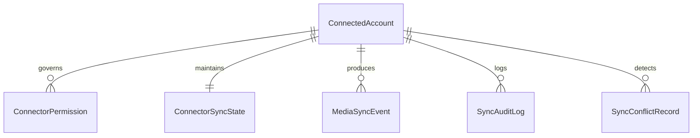

# Proposta Arquitetural — Yuki Account Connect
## Infraestrutura Compartilhada de Conexão com Contas Pessoais e Sincronização

**Versão:** 1.0  
**Status:** PROPOSTA ARQUITETURAL (Futura — Não implementada prematuramente)  
**Domínio:** 15 / 18 — Integration Gateway / Personal Account Connect / Identity Federation  
**Data:** 2026-10-13  
**Autor:** Proposta Técnica e Arquitetural para Análise e Aprovação do Proprietário  
**Referência do Projeto:** `JoseLeandroAC/YUKI`  
**Branch de Referência:** `feature/marco-8.1.1-homologation-fixes`  
**Marcos de Governança:** Marco 8.1.1 (Ativo / STT Não Homologado Fisicamente) | Marco Futuro de Implementação: Pós-Marco 8.1.1  

---

## 1. Visão Geral e Finalidade

O **Yuki Account Connect (YAC)** é concebido como a infraestrutura central, reutilizável e segura da plataforma Yuki destinada a gerenciar o ciclo de vida de conexões entre a assistente e as contas pessoais, assinaturas e serviços digitais autorizados do operador.

Em vez de cada módulo ou capacidade (como *Media Intelligence*, *Yuki Professora*, *Personal Finance*, *Smart Home* ou *Tarefas*) construir sua própria lógica de autenticação ad-hoc, o **Account Connect** unifica:
1. O registro centralizado de identidades digitais externas vinculadas ao operador;
2. O gerenciamento federado de permissões, escopos e consentimentos granulares;
3. A orquestração segura de credenciais através do `Credential Vault` da Yuki;
4. Os protocolos de sincronização de dados (tanto automáticos em segundo plano quanto sob demanda);
5. O tratamento uniforme de expiração de sessões, desconexões e direito à revogação instantânea com expurgo total de dados.

---

## 2. Invariantes Inegociáveis de Segurança, Ética e Governança

O acesso a serviços externos representa uma fronteira crítica de confiança. O Yuki Account Connect é fundamentado nas seguintes salvaguardas:

```
External Account != Internal Authority
User Consent != Unbounded Permission
Private Third-Party Boundary != Hackable Target
Data Minimization != Wholesale Scraping
```

### 2.1 Reutilização Estrita da Arquitetura do Domínio 15 e ADR-008
- **Zero Duplicação de Cofres de Segredos:** O Account Connect **não** cria arquivos secundários de senhas nem tabelas inseguras de credenciais. Todo token de acesso, refresh token, segredo de cliente ou chave de API é armazenado exclusivamente no [`Credential Vault`](file:///c:/Users/Miriã/Documents/JOSÉ/docs/adr/ADR-008_YUKI_CREDENTIAL_ISOLATION_AND_SECRET_DELIVERY.md), criptografado em repouso com ChaCha20-Poly1305 / PBKDF2 e travamento a nível de kernel de SO.
- **Isolamento por Proprietário (`owner_id`):** Todas as conexões pertencem a um proprietário explícito (ex.: `operator:primary`), prevenindo contaminação multi-tenant.
- **Princípio do Privilégio Mínimo:** Conexões solicitam apenas os escopos estritamente necessários para a função contratada (ex.: escopo de leitura de histórico `user-read-recently-played` sem exigir permissão de mutação ou deleção de biblioteca).

### 2.2 Limites Éticos e Legais Invioláveis
1. **Proibição de Evasão de Mecanismos de Segurança:** A Yuki **jamais** tentará quebrar criptografia DRM, contornar barreiras de autenticação, violar testes de CAPTCHA ou burlar proteções contra abusos implementadas por terceiros.
2. **Respeito aos Termos e Limitações de Plataforma:** O sistema atua de forma transparente, identificando-se honestamente como cliente autorizado do próprio usuário.
3. **Esclarecimento sobre APIs Intermediárias:** A criação de uma API proxy intermediária própria serve unicamente para normalizar formatos e aliviar processamento local; **uma API própria não concede nem inventa acesso a dados privados que o serviço terceiro original não disponibilize legitimamente**.

---

## 3. Os Cinco Métodos de Conexão Suportados

Para lidar com a diversidade do ecossistema digital sem presumir homogeneidade inexistente, o Account Connect estabelece 5 métodos formais de integração:

```
                            MÉTODOS DE CONEXÃO
                                     │
     ┌─────────────────┬─────────────┼─────────────┬─────────────────┐
     ▼                 ▼             ▼             ▼                 ▼
 1. OAUTH 2.0 /    2. SESSÃO DO   3. APP LOCAL  4. ARQUIVOS E     5. APIS PROXY
   APIS OFICIAIS    NAVEGADOR       (DESKTOP)     EXPORTAÇÕES      NORMALIZADAS
  (Spotify, AniList, (Extensão Local (Calibre,     (CSV, JSON,      (Serviços de
   Trakt, Google)     Autorizada)     MPD, IPC)     Takeout/GDPR)    Metadados)
```

### 3.1 Método 1: OAuth 2.0 / OpenID Connect e APIs Oficiais Abertas
- **Cenário:** Plataformas com suporte a desenvolvedores e fluxos padrão RFC 6749 (Authorization Code com PKCE).
- **Exemplos:** Spotify, AniList, Trakt.tv, Google Calendar, GitHub, Discord.
- **Funcionamento:** O usuário autoriza a Yuki em uma janela de navegador nativa; a Yuki recebe o código de autorização, troca por tokens de acesso/atualização e armazena os tokens no `Credential Vault`. A renovação (*token refresh*) ocorre de forma autônoma em segundo plano.

### 3.2 Método 2: Conectores de Navegador via Sessão Local Autorizada
- **Cenário:** Serviços culturais e de streaming que **não** possuem APIs públicas abertas de histórico de visualização (ex.: Netflix, Prime Video, Crunchyroll, Disney+, Max).
- **Funcionamento:** O usuário, estando legitimamente autenticado em seu navegador habitual no mesmo computador Windows, instala um conector local (ex.: extensão leve ou bridge IPC de navegador governada). O conector, agindo em nome do próprio usuário e sob sua autorização expressa, extrai os eventos recentes de reprodução (`watched-history`) e os entrega de forma criptografada para o runtime da Yuki.
- **Restrição:** Opera exclusivamente em tempo real no cliente local do usuário, sem compartilhamento de cookies ou credenciais brutas com servidores remotos de terceiros.

### 3.3 Método 3: Conectores de Aplicativos Locais Desktop
- **Cenário:** Softwares instalados na máquina do operador que gerenciam arquivos culturais ou mídias.
- **Exemplos:** Calibre (biblioteca de e-books SQLite), players de áudio locais (MusicBee, foobar2000, VLC) via interfaces IPC, sockets locais ou monitoramento de tags ID3 de diretórios de música.
- **Funcionamento:** Acesso somente-leitura direto a bancos de dados ou interfaces locais suportadas, sem necessidade de internet.

### 3.4 Método 4: Importação de Arquivos e Históricos Exportados
- **Cenário:** Plataformas que não suportam automação contínua, mas oferecem exportação de dados pelo usuário (direitos de portabilidade GDPR / LGPD ou recursos nativos de backup).
- **Exemplos:** Arquivos CSV exportados do Goodreads, arquivos JSON do Letterboxd, relatórios de Takeout do YouTube ou arquivos de histórico da Netflix baixados pelo usuário.
- **Funcionamento:** A Yuki oferece um comando de ingestão estruturada (`yuki connect import <file>`), normalizando e reconciliando os registros com a biblioteca canônica local.

### 3.5 Método 5: APIs Intermediárias Próprias e Serviços Normalizados
- **Cenário:** Consulta a catálogos públicos abertos e fontes de metadados enriquecidos (ex.: TMDB, Open Library, MusicBrainz).
- **Funcionamento:** A Yuki pode consumir gateways próprios ou endpoints abertos que consolidam metadados públicos sobre obras e artistas, sem jamais transitar segredos de autenticação por infraestruturas não auditadas.

---

## 4. Sincronização Automática — Requisito Confirmado pelo Proprietário

O proprietário confirmou expressamente o requisito de **registro automático de atividade nas contas conectadas**. Quando a integração estiver autorizada e configurada, a Yuki atuará proativamente para manter a inteligência cultural atualizada sem exigir intervenção manual constante.

```
                           EVENTO NO SERVIÇO EXTERNO
                      (Episódio assistido, faixa ouvida)
                                       │
                                       ▼
                          CONECTOR ACCOUNT CONNECT
                     (Detecta via polling ou webhook)
                                       │
                                       ▼
                       POLÍTICA DE SINCRONIZAÇÃO
                    ┌──────────────────┴──────────────────┐
                    ▼                                     ▼
             Modo Automático                       Modo Manual
                    │                                     │
                    ▼                                     ▼
         [LEITURA E ATUALIZAÇÃO LOCAL]            [REGISTRO PENDENTE]
          • Registra episódio concluído            Aguardar aprovação
          • Atualiza progresso da temporada        para efetivar
          • Atualiza scrobble de música
          • Detecta novas avaliações
                    │
                    ▼
     [AUDITORIA: MediaSyncEvent gravado]
```

### 4.1 Comportamento do Registro Automático
Quando a sincronização estiver ativada para uma conta conectada, a Yuki irá:
1. **Identificar obras assistidas:** Detectar novos filmes e séries iniciados ou finalizados;
2. **Registrar episódios concluídos:** Incrementar o progresso exato da temporada em segundo plano;
3. **Acompanhar literatura:** Sincronizar o progresso de leitura em aplicativos conectados (ex.: Kindle / leitores digitais com exportação);
4. **Importar histórico musical:** Registrar faixas, álbuns e artistas ouvidos no Spotify/YouTube Music;
5. **Detectar novas avaliações:** Importar notas dadas pelo usuário em plataformas externas (ex.: nota atribuída no AniList ou Trakt);
6. **Prevenir duplicações:** Descartar eventos de reprodução repetidos ocorridos na mesma janela temporal;
7. **Registrar proveniência e confiabilidade:** Cada evento recebe carimbo de data/hora, identificador da conta de origem e classificação como dado *confirmado externamente*.

### 4.2 Controles de Governança e Soberania do Usuário
- **Permissão por Categoria e Conta:** O usuário pode ativar a sincronização automática para o AniList e Spotify, mas manter a Netflix estritamente em modo manual ou desativada;
- **Separação Leitura vs Escrita:**
  - *Leitura e Atualização da Biblioteca Local da Yuki:* Pode ocorrer de forma $100\%$ automática conforme a preferência do usuário.
  - *Ações que Modificam o Serviço Externo:* Adicionar faixas a playlists públicas do usuário, alterar status remotos ou postar resenhas externas seguem políticas independentes e exigem autorização expressa;
- **Interruptor Geral (Kill-Switch):** Comando rápido para pausar ou desativar toda e qualquer sincronização em segundo plano instantaneamente:
  ```powershell
  yuki connect sync --disable-all
  ```

---

## 5. Ciclo de Vida da Conexão e Gestão de Sessões

Toda conexão gerenciada pelo Account Connect segue um ciclo de vida rigoroso:

```
[Desconectado] ──> [Autorização] ──> [Ativo / Saudável] ──> [Sincronizando]
                          │                  │                     │
                          ▼                  ▼                     ▼
                     [Rejeitado]      [Token Expirado]     [Falha Transitória]
                                             │                     │
                                             ▼                     ▼
                                     [Refresh Token]     [Backoff Exponencial]
                                             │
                                             ▼
                                    [Sessão Revogada /
                                    Exige Reautenticação]
```

1. **Registro e Pareamento:** Geração de estado de desafio (PKCE state) e solicitação de consentimento no terminal ou navegador;
2. **Armazenamento Seguro:** Segredos gravados no `Credential Vault` associados ao `account_id`;
3. **Verificação de Saúde (Health Check):** Chamadas leves de sondagem periódica para verificar se o token permanece válido;
4. **Renovação Transparente:** Disparo automático de renovação antes do término da validade do access token;
5. **Isolamento de Falhas:** A indisponibilidade de um serviço (ex.: erro 503 no AniList) **não** afeta as demais conexões nem degrada o runtime principal da Yuki;
6. **Tratamento de Sessão Revogada:** Se o usuário alterar a senha na plataforma de origem, a Yuki marca o conector como `NeedsReauthorization`, notificando com discrição e sem spam;
7. **Desconexão e Expurgo:** O usuário pode desconectar qualquer conta a qualquer momento. O Account Connect remove as credenciais do cofre, revoga os tokens remotos (se a API suportar) e oferece a opção de expurgar ou manter o histórico local previamente sincronizado.

---

## 6. Modelo Conceitual de Dados — Account Connect

A modelagem de dados do componente define as seguintes entidades:



### 6.1 Detalhamento das Entidades

1. **`ConnectedAccount`**:
   - `id`: UUID v4 único da conta conectada;
   - `owner_id`: Identificador do operador proprietário (ex.: `operator:primary`);
   - `provider`: Enum (`Spotify`, `AniList`, `MyAnimeList`, `Trakt`, `Crunchyroll`, `Goodreads`, `Custom`);
   - `account_identifier`: Nome de usuário público ou ID na plataforma remota (sanitizado, zero segredos);
   - `connection_method`: Enum (`OAuth2`, `BrowserBridge`, `LocalApp`, `FileImport`, `CustomProxy`);
   - `vault_secret_key`: Chave de referência para localização dos segredos dentro do `Credential Vault`;
   - `status`: Enum (`Active`, `NeedsReauth`, `Paused`, `Disabled`, `Revoked`);
   - `created_at` e `updated_at`: Carimbos temporais de auditoria.
2. **`ConnectorPermission`**:
   - `account_id`: Chave estrangeira para a conta;
   - `scope_name`: Escopo específico concedido (ex.: `playlist-modify-private`, `library-read`);
   - `auto_sync_read`: Booleano autorizando sincronização automática em segundo plano;
   - `allow_external_mutations`: Booleano autorizando alterações remotas (padrão `false`);
   - `requires_human_approval`: Booleano forçando aprovação a cada escrita remota.
3. **`ConnectorSyncState`**:
   - `account_id`: Chave estrangeira;
   - `last_sync_started_at`: Início da última rotina de sincronização;
   - `last_sync_completed_at`: Conclusão com sucesso;
   - `cursor_or_checkpoint`: Token de paginação ou timestamp incremental remoto;
   - `consecutive_failures`: Contador de erros para acionamento de backoff exponencial;
   - `last_error_message`: Descrição resumida da última falha (sanitizada, sem tokens).
4. **`MediaSyncEvent`**:
   - `event_id`: Identificador único do evento de sincronização;
   - `account_id`: Origem do evento;
   - `external_item_id`: Identificador do item na plataforma de origem;
   - `local_media_id`: Identificador da obra correspondente na `MediaLibrary` da Yuki;
   - `event_type`: Enum (`WatchedEpisode`, `FinishedMovie`, `ReadChapter`, `TrackPlayed`, `RatingChanged`);
   - `event_payload`: Detalhes brutos normalizados (número de episódio, timestamp de escuta, nota);
   - `is_confirmed`: Booleano (dado confirmado pela API vs inferência);
   - `synced_at`: Data e hora em que a Yuki registrou o evento.
5. **`SyncConflictRecord`**:
   - Registro de divergência entre plataformas (ex.: episódio 5 marcado no AniList e episódio 3 no MyAnimeList) mantido para auditoria e reconciliação soberana do usuário.

---

## 7. Reconciliação de Conflitos e Deduplicação

Quando o usuário consome mídias em múltiplas frentes, divergências podem ocorrer:
- **Regra de Monotonicidade de Progresso:** Um progresso menor vindo de uma fonte atrasada não substitui um progresso maior já confirmado manualmente pelo usuário;
- **Prevalência da Entrada Manual Recente:** Informações digitadas diretamente pelo usuário na Yuki possuem prioridade absoluta sobre sincronizações assíncronas externas;
- **Deduplicação por Janela Temporal:** Eventos idênticos (mesma música tocada, mesmo episódio assistido) reportados por duas fontes dentro de uma janela de 3 minutos são agrupados em um único registro lógico, preservando os dois ponteiros de proveniência para auditoria.

---

## 8. Integração com a Arquitetura da Plataforma Yuki

```
                        YUKI INTEGRATION RUNTIME
                                   │
      ┌────────────────────────────┼────────────────────────────┐
      ▼                            ▼                            ▼
Credential Vault           Integration Gateway           Security Policy
(PBKDF2/Kernel Lock)       (ADR-007 / ADR-015)           (Portão de Riscos)
      │                            │                            │
      ▼                            ▼                            ▼
Tokens Criptografados      Conectores e Roteamento       Aprovação Humana
Sem Vazamento em Disco     de Protocolos Remotos         para Ações Mutadoras
```

- **Credential Vault (Domínio 10 / ADR-008):** Armazena tokens OAuth, chaves de clientes e certificados com isolamento criptográfico por `owner_id`.
- **Integration Gateway (Domínio 15):** Provê os adaptadores de protocolo, pooling de conexões HTTP seguras (com mitigação de SSRF herdada dos Marcos 1 a 5) e limitação de taxa (*rate limiting*).
- **Security Policy:** Toda requisição mutadora que envie dados ou altere o estado de plataformas de terceiros passa pelo filtro de conformidade e verificação de efeitos externos (ADR-009).

---

## 9. Roadmap de Implementação do Account Connect

- **Fase YAC-0 — Contratos e Esquema do Cofre:** Definição das structs de conexão, enums de provedores e integração com o catálogo de credenciais do `Credential Vault`.
- **Fase YAC-1 — Módulo Core e Conectores de APIs Abertas:** Implementação dos fluxos OAuth2 com PKCE para provedores com APIs públicas maduras (Spotify, AniList, Trakt).
- **Fase YAC-2 — Sincronizador Automático em Segundo Plano:** Implementação de rotinas incrementais agendadas, tratamento de rate limiting, deduplicação e eventos de auditoria.
- **Fase YAC-3 — Conectores de Desktop e Importação de Arquivos:** Suporte a arquivos exportados (Goodreads, Letterboxd, Takeout) e pontes locais para leitores de e-books.
- **Fase YAC-4 — Conectores de Navegador via Sessão Local:** Desenvolvimento da arquitetura de bridge local autorizada para leitura de histórico em plataformas sem API aberta.
- **Fase YAC-5 — Painel de Gestão e Auditoria:** Comandos administrativos CLI para inspeção detalhada de status de contas, logs de sincronização e revogação imediata.

---

## 10. Resumo de Governança

> [!IMPORTANT]
> **Status Vigente:** Esta proposta é um documento de arquitetura futura. Nenhuma chamada de rede externa, registro de conta ou conector foi implementado prematuramente. O projeto segue focado com exclusividade na homologação física e refinamento acústico do STT do Marco 8.1.1.
