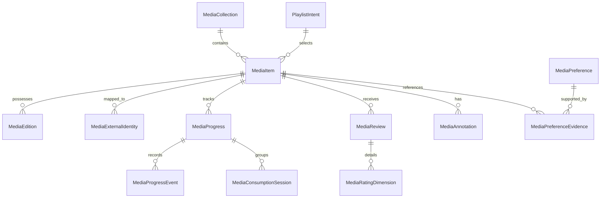

# Proposta Arquitetural — Yuki Media Intelligence
## Sistema de Inteligência Cultural, Curadoria e Entretenimento Pessoal

**Versão:** 1.0  
**Status:** PROPOSTA ARQUITETURAL (Futura — Não implementada prematuramente)  
**Domínio:** 17 — Cultural Intelligence / Personal Entertainment / Taste Modeling  
**Data:** 2026-10-13  
**Autor:** Proposta Técnica e Arquitetural para Análise e Aprovação do Proprietário  
**Referência do Projeto:** `JoseLeandroAC/YUKI`  
**Branch de Referência:** `feature/marco-8.1.1-homologation-fixes`  
**Marcos de Governança:** Marco 8.1.1 (Ativo / STT Não Homologado Fisicamente) | Marco Futuro de Implementação: Pós-Marco 8.1.1  

---

## 1. Visão Geral e Finalidade

O **Yuki Media Intelligence (YMI)** é concebido como o subsistema de inteligência cultural, entretenimento pessoal e curadoria intelectual da assistente Yuki. Sua missão transcende a simples catalogação passiva de mídias consumidas: ele atua como um companheiro intelectual, estético e emocional capaz de compreender, organizar, acompanhar e enriquecer a relação do usuário com as diversas formas de arte e entretenimento.

O sistema abrange, de forma unificada e multiformato:
- **Cinema e Obras Audiovisuais:** Filmes de longa e curta-metragem, documentários, obras experimentais;
- **Séries e Produções Ocidentais:** Temporadas, episódios, minisséries;
- **Animação Japonesa (Anime):** Séries sazonais, filmes, OVAs, ONAs, especiais;
- **Quadrinhos e Mangás:** Mangás, manhwas, manhuas, quadrinhos ocidentais (volumes e capítulos);
- **Literatura:** Livros físicos e digitais (e-books), ensaios, ficção e não-ficção;
- **Audiolivros:** Obras narradas, produções dramatizadas;
- **Música:** Faixas avulsas, álbuns conceituais, discografias, playlists, trilhas sonoras originais (OSTs);
- **Mídias Expansíveis:** Podcasts temáticos, jogos narrativos e produções teatrais.

A Yuki não atua como um banco de dados estático. Ela é projetada para:
1. Compreender **preferências culturais profundas** (estética, ritmo, construção de mundo, temas filosóficos);
2. Mapear as **experiências emocionais** provocadas pelas obras (melancolia, esperança, catarse, conforto);
3. Analisar **características narrativas** e estilos autorais;
4. Detectar **padrões de consumo temporal** e variações contextuais de humor;
5. Registrar e valorizar **avaliações explícitas do usuário**;
6. Oferecer **recomendações contextualizadas e explicáveis**, prevenindo bolhas de repetição;
7. Dialogar como uma **crítica de mídia rigorosa e sensível**, debatendo interpretações e simbolismos;
8. Realizar **curadoria musical adaptativa** em linguagem natural integrada a serviços conectados;
9. Operar com **estrita proteção contra spoilers**, sincronizada com o progresso exato do usuário.

---

## 2. O Princípio Fundamental de Personalização: «Consumo ≠ Preferência»

O erro central dos algoritmos de recomendação comercial é equivaler a métrica de engajamento/consumo à satisfação ou preferência genuína. No Yuki Media Intelligence, estabelece-se como axioma inegociável:

$$\text{Consumo Factual} \neq \text{Apreciação} \neq \text{Preferência Duradoura}$$

### 2.1 Teoremas de Separação Epistêmica

1. **Assistir a uma obra não significa gostar dela:** O usuário pode concluir uma temporada por compromisso social, curiosidade técnica, análise crítica, tédio ou investimento em franquia prévia, mesmo detestando o desfecho.
2. **Abandonar uma obra não significa considerá-la ruim:** O abandono pode decorrer de ritmo incompatível com a rotina atual, densidade emocional pesada para o momento presente, falta de tempo ou preferência por consumir em outro veículo.
3. **Repetição musical não implica favoritismo duradouro:** Uma faixa ou álbum repetido dezenas de vezes pode ser ruído de fundo para foco em matemática, relaxamento para dormir ou teste de equipamento de áudio, sem representar a identidade estética central do ouvinte.
4. **Preferência explícita tem primazia ontológica sobre inferência estatística:** Uma inferência probabilística jamais deve sobrescrever, atenuar ou distorcer uma avaliação declarada expressamente pelo usuário.

### 2.2 Matriz de Classificação Epistêmica em 9 Categorias

Toda informação cultural processada pelo YMI é classificada obrigatoriamente em uma de 9 categorias estritas:

| Categoria | Definição | Proveniência | Reversibilidade |
| :--- | :--- | :--- | :--- |
| **1. Histórico Factual de Consumo** | Registro cronológico puro de reprodução, leitura ou escuta (ex.: "Episódio 4 assistido em 12/10"). | Telemetria conectada ou informe manual. | Auditável / Imutável factualmente. |
| **2. Avaliação Explícita do Usuário** | Notas declaradas, resenhas escritas, vereditos verbais ("Nota 9/10", "Achei o final fraco"). | Entrada deliberada do usuário. | Soberana; editável apenas pelo usuário. |
| **3. Preferência Inferida pelo Sistema** | Hipótese estatística da Yuki sobre temas recorrentes ou atrativos. | Heurística / LLM / Análise de padrões. | Revogável; exige indicação de confiança ($0.0 \dots 1.0$). |
| **4. Interesse Momentâneo** | Vontade passageira atrelada a evento pontual ("Quero ver um filme de chuva hoje"). | Turno conversacional atual. | Expira por contexto temporal. |
| **5. Preferência Duradoura** | Pilares estáveis do gosto cultural (ex.: paixão por histórias sobre passagem do tempo). | Consolidação longitudinal validada. | Estável; atualizada gradualmente. |
| **6. Intenção Futura** | Lista de desejos, metas de leitura, obras aguardadas ("Quero ver quando lançar"). | Planejamento explícito. | Mutável conforme prioridades do operador. |
| **7. Preferência Contextual** | Gostos condicionados a cenário (estudo, companhia, cansaço, viagem). | Associação com marcadores contextuais. | Ativa apenas no contexto correspondente. |
| **8. Preferência de Terceiros** | Consumo compartilhado com família, amigos ou parceiro (não reflete o gosto solo). | Marcação de companhia ou sessão compartilhada. | Isolada do perfil pessoal individual. |
| **9. Informação Incerta / Incompleta** | Dados parciais (ex.: faixa ouvida sem título, livro abandonado sem motivo anotado). | Sincronização incompleta ou menção vaga. | Mantida com flag `uncertain` até confirmação. |

---

## 3. Núcleo A — Media Library (Biblioteca Cultural Pessoal)

A **Media Library** é o repositório unificado da vida cultural do usuário. Opera sob o princípio de **Identidade Canônica Local**: cada obra possui um registro soberano na base da Yuki, ao qual identidades de catálogos e serviços de streaming são vinculadas como referências externas satélites.

### 3.1 Identidade Canônica e Atributos da Obra (`MediaItem`)

Cada item da biblioteca preserva:
- `id`: UUID v4 canônico local;
- `media_type`: Enum (`Movie`, `Series`, `Anime`, `Manga`, `Book`, `Audiobook`, `MusicTrack`, `MusicAlbum`, `Podcast`, `Game`);
- `primary_title`: Título principal conforme preferência do usuário (ex.: título localizado em pt-BR ou canônico internacional);
- `alternative_titles`: Lista de títulos alternativos (título original japonês em kanji/romaji, título em inglês, variações regionais);
- `original_language`: Código ISO 639-1 da língua de origem;
- `creators`: Estrutura tipada de autoria (diretores, roteiristas, autores literários, mangakás, ilustradores, estúdios de animação, intérpretes musicais, produtores);
- `franchise_info`: Vínculo a universos compartilhados, sagas ou linhas temporais (ex.: vínculo entre *Frieren: Beyond Journey's End* anime e mangá);
- `genres_and_themes`: Taxonomia multidimensional de gêneros estruturados e temas narrativos livres;
- `release_date`: Data de lançamento da obra ou primeira exibição;
- `duration_or_extent`: Duração em minutos (audiovisual), número de páginas/capítulos (literatura), número de faixas (álbuns);
- `available_services`: Serviços de streaming onde a obra se encontra catalogada/disponível regionalmente;
- `external_ids`: Dicionário de identificadores remotos (`mal_id`, `anilist_id`, `trakt_id`, `imdb_id`, `tmdb_id`, `goodreads_id`, `isbn_10`, `isbn_13`, `spotify_uri`, etc.);
- `consumption_state`: Estado operacional de consumo do usuário;
- `progress`: Ponteiro unificado de progresso fornecido pelo subsistema `Yuki Progress Tracker`;
- `dates`: `started_at`, `completed_at`, `paused_at`, `abandoned_at`;
- `personal_rating`: Avaliação pessoal multidimensional e nota global;
- `notes_and_annotations`: Notas pessoais, anotações de margem, citações marcadas;
- `custom_tags`: Etiquetas criadas pelo usuário (ex.: `#filmes-de-conforto`, `#leitura-pesquisa-fuvest`, `#trilha-estudo`);
- `provenance_history`: Registro de auditoria indicando se os dados vieram de input manual, sincronização automática do Crunchyroll, importação do AniList ou scrobble do Spotify.

### 3.2 Máquina de Estados de Consumo (`ConsumptionState`)

A transição de estados de uma obra segue regras formais:

```
                  ┌──────────────────────┐
                  │ Quero Assistir/Ler   │
                  │ (Plan to Watch/Read) │
                  └──────────┬───────────┘
                             │
                             ▼
                  ┌──────────────────────┐
                  │      Planejado       │
                  │      (Planned)       │
                  └──────────┬───────────┘
                             │
            ┌────────────────┴────────────────┐
            ▼                                 ▼
┌──────────────────────┐           ┌──────────────────────┐
│     Em Andamento     │◄─────────►│       Pausado        │
│    (In Progress)     │           │       (Paused)       │
└───────────┬──────────┘           └──────────┬───────────┘
            │                                 │
     ┌──────┴──────────────┐                  │
     ▼                     ▼                  ▼
┌──────────────┐   ┌──────────────┐   ┌──────────────┐
│  Concluído   │   │  Abandonado  │   │  Abandonado  │
│ (Completed)  │   │  (Dropped)   │   │  (Dropped)   │
└──────┬───────┘   └──────────────┘   └──────────────┘
       │
       ├─────────────────────────────────┐
       ▼                                 ▼
┌──────────────┐                 ┌──────────────┐
│ Quero Rever/ │                 │  Aguardando  │
│    Reler     │                 │ Continuação  │
└──────────────┘                 └──────────────┘
```

- **Quero assistir / ler / ouvir:** Desejo vago ou recomendação anotada sem compromisso de data.
- **Planejado:** Obra priorizada para consumo na fila de curto/médio prazo.
- **Em andamento:** Obra com progresso ativo superior a zero e recente.
- **Pausado:** Consumo interrompido temporariamente com intenção expressa de retomada.
- **Concluído:** Obra finalizada em sua totalidade ou até o ponto máximo disponível.
- **Abandonado:** Consumo interrompido sem intenção de continuidade (com registro do motivo, se fornecido).
- **Quero rever / reler:** Obra concluída marcada para revisitação futura.
- **Aguardando continuação:** Temporada finalizada, mas nova temporada já confirmada ou mangá em hiato.
- **Favorito:** Marcador ortogonal atribuível a qualquer obra de valor afetivo ou estético excepcional.

### 3.3 Suporte a Múltiplas Versões e Adaptações

O sistema diferencia a **Entidade Intelectual Abstrata (Obra)** de suas **Manifestações Concretas (Adaptações e Edições)**:
- Uma *Light Novel*, sua adaptação em *Mangá* e sua série de *Anime* são registros `MediaItem` distintos, porém interconectados através de um vínculo canônico `MediaRelation::AdaptedFrom` ou `MediaRelation::SharedFranchise`.
- Edições literárias distintas de uma mesma obra (ex.: edição de bolso da Companhia das Letras vs edição comentada em capa dura) possuem identificadores de edição (`MediaEdition`), permitindo que a contagem de páginas seja precisa para a cópia física exata em mãos do leitor, sem confundir o progresso nem gerar obras duplicadas na estante global.

---

## 4. Núcleo B — Taste Engine (Mecanismo de Análise de Preferências)

O **Taste Engine** constrói um perfil de gosto explicável, dimensional e sensível ao tempo. Ele não reduz o usuário a um vetor numérico opaco ou a rótulos simplistas de marketing ("fã de ação").

### 4.1 As Cinco Dimensões Culturais do Gosto

```
                      PERFIL DE GOSTO CULTURAL DA YUKI
                                     │
     ┌───────────────┬───────────────┼───────────────┬───────────────┐
     ▼               ▼               ▼               ▼               ▼
 1. NARRATIVA   2. EXPERIÊNCIA   3. VÍNCULOS    4. ESTÉTICA      5. MÚSICA
                   EMOCIONAL     INTERPESSOAIS
  • Construção   • Melancolia    • Romance       • Animação      • Energia
    de Mundo     • Esperança       Gradual       • Fotografia    • Timbre
  • Coerência    • Conforto      • Amizade e     • Direção       • Harmonia
  • Ritmo        • Tensão e        Lealdade        de Arte       • Vocais /
  • Diálogos       Catarse       • Dinâmica      • Atmosfera       Instrumental
  • Simbolismo   • Reflexão        Familiar        Visual        • Contexto
```

1. **Dimensão Narrativa:**
   - *Construção de Mundo (World-Building):* Preferência por consistência lógica interna, história pregressa rica e detalhes cotidianos;
   - *Coerência & Consequência:* Apreço por mundos onde escolhas possuem peso e custos irreversíveis;
   - *Complexidade Estrutural:* Não-linearidade temporal, múltiplos pontos de vista vs foco intimista;
   - *Ritmo (Pacing):* Contemplativo, cadenciado, deliberado vs dinâmico e acelerado;
   - *Desenvolvimento de Personagens:* Foco em arcos de maturação moral, contradições e psicologia crível;
   - *Diálogos:* Filosoficamente densos, naturais, poéticos ou esparsos;
   - *Simbolismo e Subtexto:* Capacidade da obra de comunicar além da literalidade dos eventos.
2. **Dimensão da Experiência Emocional:**
   - *Melancolia:* Sensibilidade à passagem irreversível do tempo, despedidas e beleza triste (*mono no aware*);
   - *Esperança:* Histórias onde a luz prevalece após sofrimento genuíno (otimismo conquistado, não ingênuo);
   - *Conforto (Iyashikei):* Obras que promovem serenidade, desaceleração e acolhimento cotidiano;
   - *Tensão & Catarse:* Construção gradual de suspense que culmina em resolução dramática;
   - *Nostalgia:* Evocação de memórias, eras passadas e sentimentos de pertencimento;
   - *Reflexão Existencial:* Questionamentos sobre finitude, dever, memória e identidade.
3. **Dimensão dos Relacionamentos Interpessoais:**
   - *Romance Gradual e Orgânico:* Apreço por desenvolvimentos lentos baseados em respeito mútuo e amadurecimento dos pares;
   - *Amizade e Camaradagem:* Laços fraternos construídos no enfrentamento conjunto de desafios;
   - *Relações Familiares Complexas:* Tensões intergeracionais, cuidado parental e reconciliações;
   - *Mentoria:* Relações de mestre e discípulo, passagem de tocha e legado moral.
4. **Dimensão Estética e Audiovisual:**
   - *Animação e Movimento:* Preferência por animação tradicional desenhada à mão, sakuga de impacto ou sutileza de linguagem corporal;
   - *Fotografia e Iluminação:* Cinematografia contemplativa, uso dramático de sombras, paletas outonais ou frias;
   - *Direção de Arte:* Detalhamento arquitetônico, cenários naturais ricos, design expressivo;
   - *Trilha Sonora (OST):* Arranjos orquestrais clássicos, violino, piano intimista, ambient folk.
5. **Dimensão Musical:**
   - *Energia e Dinâmica:* Baladas acústicas suaves vs faixas enérgicas de alta intensidade;
   - *Timbre e Textura:* Instrumentos de cordas acústicas, piano solo, guitarras atmosféricas, sintetizadores quentes;
   - *Arranjos Vocais:* Predileção por peças instrumentais puras vs vocais expressivos femininos/masculinos ou duetos;
   - *Língua e Poética:* Letras em português, japonês, inglês ou faixas instrumentais sem idioma;
   - *Contexto Funcional:* Foco profundo (estudo/programação), descanso, contemplação, caminhada, direção.

### 4.2 Explicabilidade e Evolução Longitudinal

- **Perfis Explicáveis:** O sistema expressa o gosto em argumentos estruturados legíveis:  
  *"O operador demonstra alta afinidade por obras de fantasia não pelos clichês heroicos de batalha, mas quando a magia serve como pano de fundo para reflexões contemplativas sobre finitude, memória e a lentidão do amadurecimento humano."*
- **Coexistência de Preferências Divergentes:** O motor não trata o gosto como um conjunto homogêneo. Ele reconhece que o usuário pode apreciar comédia nonsense para relaxamento após o trabalho, sem que isso invalide sua busca primária por literatura russa densa para fins de estudo aos finais de semana.
- **Evolução no Tempo:** Preferências possuem carimbo temporal. O sistema observa migrações de gosto sem descartar o histórico de apreço clássico da juventude.

---

## 5. Núcleo C — Media Critic (Diálogo Crítico e Análise)

O **Media Critic** é o módulo conversacional da Yuki voltado para a discussão analítica sobre arte, literatura, cinema e música. A Yuki é instruída a agir não como um assistente condescendente que concorda mecanicamente com o usuário, mas como uma **interlocutora intelectualmente honesta, perspicaz e bem-fundamentada**.

### 5.1 Capacidades Analíticas

- **Debate de Interpretações:** Discutir o significado de finais abertos, metáforas centrais e motivações de personagens;
- **Análise de Personagens:** Avaliar arcos morais, hipocrisias, forças e vulnerabilidades à luz da coerência narrativa;
- **Confronto Respeitoso de Ideias:** Se o usuário elogiar uma decisão narrativa que gerou inconsistência lógica com as premissas estabelecidas da obra, a Yuki pode apontar com polidez e argumentos sólidos:  
  *"Entendo por que essa cena causou impacto emocional imediato, mas se considerarmos o que foi estabelecido no episódio 3 sobre as limitações daquele personagem, a resolução soa um pouco artificial porque..."*
- **Comparação de Adaptações:** Cotejar o livro original com o filme, apontando o que foi perdido, enriquecido ou alterado na linguagem cinematográfica;
- **Auxílio em Resenhas:** Ajudar o usuário a articular suas próprias impressões em textos coesos, recuperando notas tomadas durante o consumo;
- **Memória Crítica Histórica:** Recordar opiniões passadas para contrastar percepções:  
  *"Interessante você ter achado essa obra prolixa. Há dois anos, quando terminou o clássico da mesma autora, você havia destacado que a lentidão das descrições foi justamente o ponto alto da imersão."*

### 5.2 Separação Rigorosa dos Discursos

A Yuki deve separar com clareza cristalina cinco planos de enunciação:

```
[Discurso da Yuki]
   ├── 1. Opinião do Usuário: ("Você destacou que o protagonista foi injustiçado...")
   ├── 2. Interpretação da Yuki: ("Sob uma ótica simbólica, interpreto que ele personificava...")
   ├── 3. Fato da Obra: ("No cânone do capítulo 42, ele de fato assinou o termo...")
   ├── 4. Recepção Crítica Externa: ("A crítica especializada na época apontou que...")
   └── 5. Hipótese Aberta: ("É plausível conjecturar que o autor pretendia...")
```

### 5.3 Sistema Governamental de Proteção contra Spoilers

A revelação prematura de acontecimentos de uma obra estraga a experiência do usuário e quebra a confiança na assistente. O YMI estabelece um protocolo inviolável de proteção:

```
                          CONSULTA SOBRE OBRA
                                   │
                                   ▼
                   Verificar Progresso no Tracker
                  (ex.: Usuário no Livro 2, Cap. 14)
                                   │
                                   ▼
                Avaliar Informação a Ser Mencionada
                                   │
             ┌─────────────────────┴─────────────────────┐
             ▼                                           ▼
      Contida no Cap. <= 14                      Contida no Cap. > 14
             │                                           │
             ▼                                           ▼
      [PERMITIDO]                              [BLOQUEIO DE SPOILER]
  Mencionar livremente                   Omitir fato ou solicitar autorização:
                                         "Essa discussão envolve eventos do
                                         capítulo 18. Deseja que eu prossiga?"
```

- **Alinhamento Granular:** O sistema checa minuto, episódio, temporada, capítulo ou página antes de formular respostas;
- **Proteção em Recomendações:** Sinopses e justificativas de recomendação são estritamente pré-exposição (zero revelação de reviravoltas do meio ou fim da obra);
- **Liberação Explícita:** Se o usuário solicitar deliberadamente: *"Pode me contar quem é o vilão, não me importo com spoilers"*, a Yuki atende, registrando o consentimento na sessão.

---

## 6. Núcleo D — Music Curator (Curadoria Musical Personalizada)

O **Music Curator** gerencia a vida musical do operador com sensibilidade poética e rigor técnico, compreendendo comandos expressos em linguagem natural rica.

### 6.1 Exemplos de Consultas e Atuação

- *"Yuki, cria uma playlist tranquila para estudar matemática."*  
  $\rightarrow$ Seleciona peças acústicas/ambientais com andamento moderado constante (60-80 BPM), timbre limpo (piano, cordas), harmonia contínua sem quebras abruptas de dinâmica e ausência de vocais compreensíveis que disputem a área de Broca durante o raciocínio analítico.
- *"Yuki, quero músicas melancólicas, mas com uma sensação de esperança."*  
  $\rightarrow$ Mapeia faixas em tonalidades menores com resolução em acordes maiores, melodias que começam intimistas e constroem um crescendo caloroso de redenção.
- *"Yuki, monta uma playlist com trilhas instrumentais de animes."*  
  $\rightarrow$ Garimpa faixas compostas por mestres do meio (Joe Hisaishi, Kevin Penkin, Evan Call, Yuki Kajiura, Hiroyuki Sawano) alinhadas ao clima solicitado.
- *"Yuki, encontra músicas parecidas com essa, mas com menos vocais."*  
  $\rightarrow$ Analisa a assinatura acústica da faixa de referência (tempo, instrumentação, densidade) e busca contrapartidas puramente instrumentais ou com coros esparsos.

### 6.2 Gestão de Playlists e Regras de Segurança Externa

- **Permissões Granulares:** A Yuki nunca sobrescreve ou apaga playlists externas no Spotify sem autorização explícita;
- **Deduplicação Inteligente:** Evita inserir faixas duplicadas na mesma playlist;
- **Versões e Edições:** Trata com inteligência versões de estúdio vs gravações ao vivo (*Live*), edições remasterizadas, versões acústicas e remixes, selecionando a variante adequada ao propósito;
- **Respeito à Disponibilidade Regional:** O sistema investiga os códigos de catálogo regional (ISRC) antes de assumir que uma faixa específica está tocável na conta do usuário.

---

## 7. Núcleo E — Media Discovery (Recomendações Contextuais e Explicáveis)

O módulo **Media Discovery** responde ao desafio de responder à pergunta: *"O que eu deveria assistir, ler ou ouvir agora?"*.

### 7.1 Matriz de Ponderação Multi-Fatorial

Para formular uma recomendação, a Yuki avalia:
1. **Preferências Históricas:** Pilares consolidados do gosto do operador;
2. **Clima e Atmosfera Desejados:** Humor declarado no momento presente;
3. **Tempo Disponível:** *"Tenho apenas 40 minutos livres"* $\rightarrow$ Sugere um episódio de anime curto ou dois capítulos de mangá, e nunca um épico cinematográfico de 3 horas;
4. **Companhia:** Consumo solitário vs noite de cinema com familiares ou amigos;
5. **Plataforma Disponível:** Serviços com assinatura ativa confirmada na residência;
6. **Idioma e Formato:** Preferência por áudio original legendado vs dublagem;
7. **Progresso em Franquias:** Priorizar a continuação de sagas já iniciadas antes de sugerir novas franquias desconhecidas;
8. **Obras Abandonadas:** Evitar autores ou formatos que compartilhem a mesma causa raiz de abandono prévio;
9. **Desejo de Exploração:** O usuário pode sinalizar: *"Quero algo completamente diferente do que costumo ver"*;
10. **Tópicos Sensíveis (Gatilhos / Antipatizantes):** Respeito estrito a temas que o usuário declarou preferir evitar (ex.: violência gratuita, cinismo excessivo).

### 7.2 O Princípio Anti-Bolha e Justificativas Claras

- Toda recomendação é acompanhada dos **motivos concretos** de sua escolha:  
  *"Recomendo 'A Silent Voice' porque você pediu um drama sensível sobre relacionamentos humanos com desenvolvimento real de maturidade. A animação da Kyoto Animation possui a fotografia calorosa e o cuidado com linguagem corporal que você destacou em obras anteriores, e a duração cabe com precisão no seu tempo livre de hoje."*
- **Sementes Exploratórias:** A Yuki reserva um espaço controlado para sugerir obras fora do padrão usual, estimulando a ampliação do repertório estético do operador sem impor escolhas.

---

## 8. Núcleo F — Media Connect (Integrações com Plataformas Culturais)

O **Media Connect** é o conjunto de conectores e adaptadores responsáveis por interligar o ecossistema cultural da Yuki aos serviços e plataformas do mundo real.

### 8.1 Ecossistema de Serviços Candidatos

```
                            PLATAFORMAS CULTURAIS
                                      │
     ┌──────────────────┬─────────────┴─────┬──────────────────┐
     ▼                  ▼                   ▼                  ▼
STREAMING VÍDEO    MÚSICA & ÁUDIO       TRACKERS         LITERATURA
  • Crunchyroll      • Spotify            • AniList        • Goodreads
  • Netflix          • YouTube            • MyAnimeList    • Skoob
  • Prime Video      • YouTube Music      • Trakt.tv       • Leitores locais
  • Disney+ / Max                         • Letterboxd       (Kindle/Calibre)
```

### 8.2 Honestidade Técnica sobre APIs e Limitações da Realidade

O projeto YUKI recusa premissas ingênuas de que "todas as plataformas possuem APIs públicas abertas e generosas":
- **Serviços com APIs Oficiais Abertas:** Spotify (Web API robusta com OAuth2), AniList (GraphQL excelente e documentada), Trakt.tv (API REST madura com scrobble), YouTube Data API (com cotas rigorosas);
- **Serviços Sem API Pública de Histórico:** Netflix, Prime Video, Disney+, Max e Crunchyroll não disponibilizam endpoints abertos para terceiros consultarem o histórico de consumo em tempo real de seus usuários.
- **Estratégias Reais e Legítimas:**
  1. *Trackers Intermediários Consensuais:* Trakt.tv (para séries/filmes ocidentais) e AniList/MyAnimeList (para animes/mangás), onde o usuário já mantém ou conecta seus scrobbles;
  2. *Conectores de Navegador via Sessão Própria:* Extensões ou automações de sessão local autorizada no navegador da máquina do usuário (lendo os metadados de histórico com autorização expressa);
  3. *Importação de Históricos e Arquivos Exportados:* Ingestão de relatórios GDPR/Takeout (ex.: histórico completo de visualização em CSV/JSON exportado da Netflix ou Goodreads);
  4. *Integração com Repositórios Locais:* Leitura de metadados do Calibre, bibliotecas locais de e-books em EPUB/PDF e pastas de música com tags ID3v2.

---

## 9. Modelo Conceitual de Dados — Media Intelligence

A modelagem de dados da proposta reflete as necessidades de integridade, proveniência e temporalidade:



### 9.1 Definição das Entidades Principais

1. **`MediaItem`**: Obra canônica com identidade única no sistema, títulos, criadores, tipo de mídia e metadados estruturais.
2. **`MediaEdition`**: Edição física ou digital específica (ISBN, número de páginas, tradutor, formato).
3. **`MediaSeries` / `MediaFranchise`**: Agrupamento canônico de obras relacionadas (sagas, temporadas, sequências).
4. **`MediaExternalIdentity`**: Par `(provider, remote_id, metadata_uri, last_synced_at)` mapeando a obra aos catálogos mundiais.
5. **`MediaProgress`**: Estado agregado do progresso atual na obra (gerenciado pelo Progress Tracker).
6. **`MediaProgressEvent`**: Evento atômico de alteração de progresso (quem alterou, data/hora, unidade anterior, unidade nova, fonte).
7. **`MediaConsumptionSession`**: Sessão contínua de consumo (ex.: leitura de 45 minutos no domingo à tarde, da página 30 à página 68).
8. **`MediaReview`**: Resenha e avaliação textual global atribuída pelo usuário ou elaborada com o auxílio da Yuki.
9. **`MediaRatingDimension`**: Notas fracionadas por dimensão analítica (Enredo, Personagens, Arte/Animação, Trilha Sonora, Desfecho).
10. **`MediaAnnotation`**: Comentários de margem, citações marcadas e notas contextuais atreladas a pontos exatos do progresso.
11. **`MediaPreference`**: Item de gosto sintetizado pelo Taste Engine (dimensão, valor, peso, polaridade, explicação gerada).
12. **`MediaPreferenceEvidence`**: Vínculo auditável entre uma preferência inferida e as obras/avaliações concretas que a sustentam.
13. **`MediaWatchlist` / `MediaCollection`**: Listas organizadas pelo usuário ("Clássicos para rever", "Leituras da FUVEST", "Melhores animes de 2024").
14. **`MediaRecommendation`**: Registro de uma recomendação formulada pela Yuki, incluindo data, obras sugeridas, justificativa, aceitação ou recusa pelo usuário.
15. **`PlaylistIntent`**: Definição declarativa de uma playlist solicitada (humor, ritmo, restrições vocais, destino de exportação).

---

## 10. Exemplos de Experiências Futuras de Ponta a Ponta

### Cenário A — Conclusão Automática e Avaliação de Anime
1. O usuário assiste ao último episódio da temporada de um anime no Crunchyroll.
2. A integração autorizada detecta o evento de conclusão através do scrobble no AniList vinculado.
3. A Yuki atualiza o estado da obra para `Completed` e o progresso para $12/12$ episódios na Media Library local.
4. No próximo turno de diálogo propício, a Yuki pontua discretamente:  
   *"José, vi que você concluiu a primeira temporada de Frieren. Quando tiver um momento livre, gostaria de registrar sua avaliação ou conversar sobre o arco final?"*
5. O usuário comenta verbalmente: *"Foi maravilhoso, dou nota 9.5. O ritmo calmo com foco na passagem do tempo me tocou muito."*
6. A Yuki registra a nota explícita, anota os comentários e atualiza o Taste Engine, reforçando o peso da dimensão emocional *Melancolia/Passagem do Tempo*.

### Cenário B — Recomendação Contextual Noturna sem Spoilers
1. Sexta-feira, 22h30. O usuário pergunta por voz:  
   *"Yuki, quero um filme de animação bonito e reflexivo para ver agora à noite. Algo que não seja barulhento nem longo demais, pois estou cansado."*
2. A Yuki consulta o Taste Engine e a biblioteca:
   - Filtra filmes com duração $\le 110\text{ min}$;
   - Busca atmosfera contemplativa/lírica;
   - Checa serviços com assinatura ativa local;
   - Verifica que o filme já foi visto ou não, respeitando o histórico.
3. A Yuki sugere:  
   *"Sugiro 'O Conto da Princesa Kaguya' ou 'Palavras que Borbulham como Refrigerante'. Se você busca algo intimista e poético, Kaguya tem uma direção de arte em aquarela deslumbrante e ritmo meditativo, disponível no seu catálogo. Prometo que nenhuma revelação sobre o desfecho será adiantada."*

### Cenário C — Leitura Literária Interrompida e Resumida
1. Durante a tarde, o usuário diz: *"Yuki, parei na página 142 de Crime e Castigo."*
2. A Yuki delega a instrução ao Progress Tracker, que atualiza a edição de posse do leitor para a página 142 ($32\%$ do total da obra).
3. Três dias depois, o leitor retoma o livro: *"Yuki, onde foi que eu parei no livro que estava lendo?"*
4. A Yuki responde imediatamente:  
   *"Você parou na página 142 de Crime e Castigo, logo no início da conversa entre Raskólnikov e Razumíkhin após a visita do médico. Você também havia deixado uma anotação sobre a febre do protagonista."*

### Cenário D — Criação de Playlist Funcional de Estudo no Spotify
1. O usuário diz: *"Yuki, cria uma playlist tranquila para estudar matemática."*
2. A Yuki formula um `PlaylistIntent`:
   - Gênero: Neo-clássico / Ambient / Lofi Instrumental / Piano Solo;
   - Restrição estrita: Zero vocais líricos;
   - Andamento: 65 a 75 BPM contínuo;
   - Duração almejada: 90 minutos.
3. O Music Curator seleciona 26 faixas coerentes e submete ao Account Connect.
4. O conector autenticado do Spotify cria uma nova playlist pessoal intitulada `"Yuki — Foco & Matemática"` na conta do usuário, adicionando as faixas sem duplicatas e retornando o link direto.

### Cenário E — Discussão Crítica Profunda e Respeitosa
1. O usuário diz: *"Yuki, terminei Evangelion 3.0+1.0. Sinceramente, achei que o final traiu todo o pessimismo realista da série clássica."*
2. A Yuki recupera as anotações do usuário sobre o anime original de 1995 e formula uma reflexão dialética:  
   *"Compreendo perfeitamente o seu desconforto. A série clássica e o filme 'End of Evangelion' eram retratos viscerais da depressão clínica e da incapacidade de reconciliação de Hideaki Anno na época. No entanto, o final de 'Thrice Upon a Time' foi construído 25 anos depois, refletindo a superação pessoal do próprio autor e uma mensagem sobre aprender a viver no mundo real em vez de se refugiar na ficção. Você considera que a obra traiu a premissa artística original, ou que ela simplesmente documentou o amadurecimento humano do seu criador?"*

### Cenário F — Reconciliação Multi-Plataforma sem Duplicatas
1. O usuário marca um anime como "Assistindo" no aplicativo do Crunchyroll no celular.
2. Na manhã seguinte, atualiza o mangá correspondente no leitor digital.
3. O Media Connect recebe os eventos de sincronização de ambas as fontes.
4. O sistema reconhece a relação entre as mídias, mantém os progressos devidamente separados em suas respectivas entidades (`MediaItem` de Anime vs `MediaItem` de Mangá), e preserva o histórico de origem de cada evento sem mesclar dados de forma confusa.

---

## 11. Integração com a Arquitetura da Plataforma Yuki

O Yuki Media Intelligence conecta-se harmoniosamente aos domínios existentes da plataforma:

```
                          YUKI CORE PLATFORM
                                  │
     ┌───────────────────┬────────┴──────────┬───────────────────┐
     ▼                   ▼                   ▼                   ▼
  Memory v1        Personal Context     Personality        Missions &
(FTS5 Relacional)   (Prompt Budget)     (Identidade)       Background
     │                   │                   │                   │
     ▼                   ▼                   ▼                   ▼
Persistência e      Injeção de Gosto     Tom de Crítica    Sincronização
Recuperação de      Cultural no Contexto  Respeitoso e      Assíncrona
Obras e Resenhas    do Diálogo Ativo     Sem Bajulação     Periódica
     │                   │                   │                   │
     └───────────────────┼───────────────────┘                   │
                         ▼                                       │
              CAPABILITY REGISTRY & SECURITY                     │
                         │                                       │
                         ▼                                       │
              INTEGRATION GATEWAY & VAULT ◄──────────────────────┘
                         │
                         ▼
             YUKI ACCOUNT CONNECT & EXTERNAL
```

- **Memory v1:** Persistência relacional protegida com isolamento por `owner_id`, garantindo que notas culturais não vazem entre perfis;
- **Personal Context:** O `PersonalContextBuilder` aloca uma fatia governada no orçamento de tokens para sintetizar preferências culturais quando o usuário solicita recomendações ou inicia diálogos artísticos;
- **Personality:** A Yuki adota seu estilo comunicativo canônico: gentil, inteligente, atenta e intelectualmente honesta, sem simular senciência biológica;
- **Credential Vault & Integration Gateway:** Todas as credenciais de acesso (tokens OAuth do Spotify, chaves de API do Trakt) são armazenadas de forma criptografada no cofre do sistema, sem qualquer vazamento em texto plano;
- **Security Policy:** Operações destrutivas externas (como apagar uma playlist antiga de 500 músicas) exigem obrigatoriamente confirmação explícita do operador humano.

---

## 12. Roadmap Futuro de Implementação

A evolução do Yuki Media Intelligence é dividida em 7 fases ordenadas e mutuamente independentes:

- **Fase YMI-0 — Especificação e Contratos Formais:** Elaboração completa dos contratos Rust em `src/contracts/media.rs`, schemas de banco relacional e regras de validação.
- **Fase YMI-1 — Biblioteca Cultural e Progresso Local:** Implementação da Media Library soberana offline, gerenciamento local de listas e máquina de estados de consumo.
- **Fase YMI-2 — Perfil Cultural e Recomendações:** Implementação do Taste Engine multidimensional, algoritmos de similaridade explicável e recomendações anti-bolha.
- **Fase YMI-3 — Discussão e Crítica:** Implementação do Media Critic, ferramentas de auxílio em resenhas e sistema de proteção inviolável contra spoilers.
- **Fase YMI-4 — Account Connect e Primeiras Integrações:** Conectores oficiais com serviços com APIs abertas (Spotify, AniList, Trakt) e gestão de tokens no Credential Vault.
- **Fase YMI-5 — Sincronização Ampliada e Reconciliação:** Scrobbling automático multi-plataforma, ingestão de dados de navegadores e relatórios de exportação manual.
- **Fase YMI-6 — Inteligência Cultural Proativa:** Retrospectivas culturais periódicas ("Seu Mês em Obras"), descobertas antecipadas de lançamentos de interesse e integração profunda por voz.

---

## 13. Resumo de Governança

> [!IMPORTANT]
> **Status Vigente:** Esta proposta é um documento de planejamento arquitetural e visão de longo prazo. Nenhuma linha de código operacional, conector externo, migration de banco de dados ou integração de rede foi iniciada prematuramente. O foco ativo do projeto permanece estritamente na homologação física e estabilização do subsistema de voz do Marco 8.1.1.
