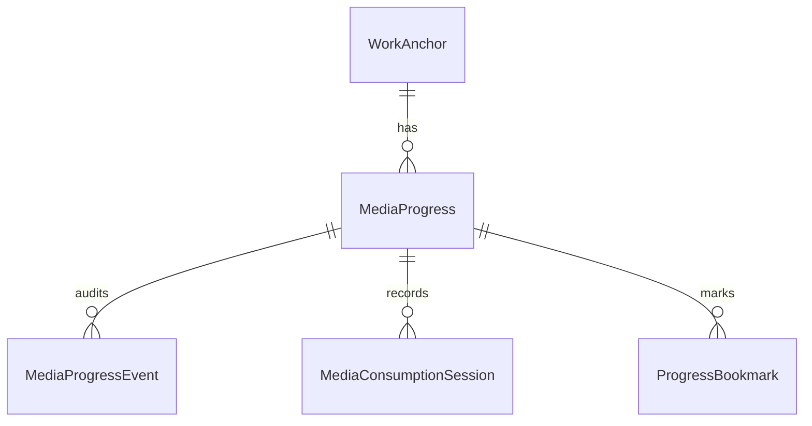

# Proposta Arquitetural — Yuki Progress Tracker
## Mecanismo Unificado e Reutilizável de Acompanhamento de Progresso

**Versão:** 1.0  
**Status:** PROPOSTA ARQUITETURAL (Futura — Não implementada prematuramente)  
**Domínio:** 19 — Progress Tracking / Activity Modeling / Longitudinal Continuity  
**Data:** 2026-10-13  
**Autor:** Proposta Técnica e Arquitetural para Análise e Aprovação do Proprietário  
**Referência do Projeto:** `JoseLeandroAC/YUKI`  
**Branch de Referência:** `feature/marco-8.1.1-homologation-fixes`  
**Marcos de Governança:** Marco 8.1.1 (Ativo / STT Não Homologado Fisicamente) | Marco Futuro de Implementação: Pós-Marco 8.1.1  

---

## 1. Visão Geral e Propósito

O **Yuki Progress Tracker (YPT)** é concebido como uma infraestrutura universal, agnóstica e altamente especializada da Yuki destinada a modelar, registrar, calcular e recuperar o progresso humano ao longo de jornadas sequenciais no tempo.

Em sistemas convencionais, o controle de progresso é frequentemente implementado como um atributo frágil e descartável (ex.: uma simples coluna inteira `current_page = 150` ou `current_episode = 4`), o que destrói o histórico de sessões anteriores, impede releituras, falha diante de edições diferentes e não suporta a riqueza de interações em linguagem natural.

O **Yuki Progress Tracker** foi projetado para ser um componente transversal reutilizável por múltiplas capacidades da Yuki:
1. **Yuki Media Intelligence:** Filmes, séries, animes, mangás, livros físicos, e-books e audiolivros;
2. **Yuki Professora:** Acompanhamento de cronogramas de estudo, matérias, módulos de revisão e listas de exercícios (ex.: simulados da FUVEST, problemas da OBMEP);
3. **Cursos e Certificações:** Aulas assistidas, módulos concluídos, tarefas submetidas e laboratórios práticos;
4. **Projetos e Metas Pessoais:** Marcos concluídos, entregas sequenciais e sprints de leitura.

---

## 2. Modelos Especializados de Progresso por Domínio

Cada formato de mídia ou atividade humana possui granularidades e unidades de medida intrínsecas. O Tracker implementa modelos formais tipados para cada um:

```
                            MODELOS DE PROGRESSO
                                     │
     ┌─────────────────┬─────────────┼─────────────┬─────────────────┐
     ▼                 ▼             ▼             ▼                 ▼
  LIVRO             MANGÁ     ANIME & SÉRIE      FILME &         CURSO &
(LITERATURA)    (QUADRINHOS)  (AUDIOVISUAL)    AUDIOLIVRO       ACADÊMICO
 • Página        • Volume      • Temporada      • Minuto/Segundo • Módulo
 • Total Pág.    • Capítulo    • Episódio       • Duração Total  • Aula
 • Capítulo      • Página      • Minuto/Frame   • Posição        • Exercícios
 • Edição        • Estado Pub. • Especiais/OVAs   Temporal       • Simulado
```

### 2.1 Modelo Literário (Livros Físicos e Digitais)
O progresso em literatura considera a edição física ou eletrônica exata em uso pelo operador:
- `work_id`: Referência canônica da obra;
- `edition_id`: Identificador da edição específica (ISBN-10, ISBN-13, ASIN, editora, formato);
- `current_page`: Número da página atual onde o leitor parou;
- `total_pages`: Total de páginas da edição cadastrada;
- `current_chapter`: Nome ou número do capítulo corrente;
- `percentage_completed`: Percentual exato normalizado ($0.0 \dots 100.0\%$);
- `reading_pace`: Cadência estimada (páginas por minuto / páginas por hora baseadas nas sessões ativas);
- `bookmarks_and_notes`: Anotações e citações atreladas à página exata;
- `updated_at`: Carimbo de data e hora do último informe.

### 2.2 Modelo de Quadrinhos e Mangás
Os mangás combinam periodicidade de capítulos semanais/mensais e encadernações em volumes (tankobon):
- `series_id`: Identificador canônico da série;
- `current_volume`: Número do volume físico/compilado;
- `current_chapter`: Número do capítulo (com suporte a decimais, ex.: Cap. 42.5);
- `current_page`: Página interna do capítulo atual (opcional);
- `publication_status`: Enum (`Publishing`, `Completed`, `OnHiatus`, `Discontinued`);
- `release_gap`: Indica se o leitor alcançou o último capítulo publicado no Japão (*caught up*).

### 2.3 Modelo Audiovisual (Animes, Séries e Desenhos)
Estrutura hierárquica baseada em temporadas e episódios:
- `series_id`: Identificador canônico da produção;
- `season_number`: Número da temporada (ou bloco de exibição/cour);
- `episode_number`: Número sequencial do episódio na temporada;
- `absolute_episode_number`: Numeração absoluta em séries longas (ex.: One Piece ep. 1080);
- `timestamp_seconds`: Minuto/segundo de interrupção (opcional, para retomada no ponto exato);
- `specials_and_ovas`: Registro de episódios especiais fora da numeração canônica (OVAs, ONAs, filmes canônicos intermediários);
- `completion_status`: Estado da temporada corrente ($N/M$ episódios concluídos).

### 2.4 Modelo Cinematográfico (Filmes)
Obras de exibição contínua sem fragmentação em episódios:
- `movie_id`: Identificador canônico do filme;
- `current_playback_seconds`: Ponto temporal de parada em segundos;
- `total_duration_seconds`: Duração total da obra;
- `is_mid_credits_reached`: Flag indicando se o espectador assistiu até o início dos créditos ou cena pós-créditos.

### 2.5 Modelo de Audiolivros e Áudio Narrado
- `audiobook_id`: Identificador canônico da obra narrada;
- `current_part_or_track`: Número do arquivo ou parte do audiolivro;
- `playback_offset_seconds`: Posição exata em segundos dentro da faixa;
- `remaining_time_seconds`: Tempo restante estimado para conclusão da obra na velocidade de reprodução atual ($1.0\times$, $1.25\times$, etc.).

### 2.6 Modelo Educacional e Acadêmico (Yuki Professora / Cursos)
Estrutura voltada à retenção e domínio de conteúdo:
- `course_id` / `subject_id`: Identificador do curso ou disciplina de estudo (ex.: "Física — Mecânica Clássica");
- `current_module`: Identificador do módulo programático;
- `current_lesson`: Aula ou tópico teórico corrente;
- `exercises_completed`: Contador de exercícios resolvidos na lista atual;
- `exercises_total`: Total de exercícios propostos;
- `accuracy_rate`: Taxa de acerto acumulada no tópico ($TP / Total$).

---

## 3. Interação Fluida em Linguagem Natural

A grande força do Progress Tracker na Yuki é permitir que o usuário atualize e consulte seu progresso em conversação natural, por voz ou texto, sem preencher formulários rígidos:

```
                  ENTRADA DO USUÁRIO EM LINGUAGEM NATURAL
             ("Yuki, parei na página 147 de Memórias de Martha")
                                     │
                                     ▼
                    PARSER SEMÂNTICO & RESOLVER DE ENTIDADE
             (Mapeia intenção, quantidade, unidade e obra)
                                     │
                                     ▼
                     AVALIAÇÃO DE AMBIGUIDADE
                ┌────────────────────┴────────────────────┐
                ▼                                         ▼
         Entidade Única                            Múltiplas Obras
          Identificada                               Compatíveis
                │                                         │
                ▼                                         ▼
      REGISTRO DO PROGRESSO                      PEDIDO DE ESCLARECIMENTO
   Atualiza ponteiro, registra                   "Você se refere ao livro
   sessão e confirma verbalmente                 físico ou ao audiolivro?"
```

### 3.1 Exemplos de Comandos Suportados

- *"Yuki, parei na página 147 de Memórias de Martha."*  
  $\rightarrow$ Localiza a obra literária ativa, calcula o percentual de conclusão e atualiza o marcador.  
  *Resposta da Yuki:* *"Anotado! Você está na página 147 de Memórias de Martha, restando 63 páginas para o fim do livro."*
- *"Yuki, terminei o episódio 8 da segunda temporada de Jujutsu Kaisen."*  
  $\rightarrow$ Incrementa a temporada 2 para o episódio 8 e checa se há episódios restantes na temporada.  
  *Resposta da Yuki:* *"Progresso registrado: Temporada 2, episódio 8 concluído. Faltam 15 episódios para concluir a temporada."*
- *"Yuki, estou no capítulo 36 desse mangá."*  
  $\rightarrow$ Usa o contexto da conversa recente para resolver "desse mangá" e avança o progresso para o capítulo 36.
- *"Yuki, onde foi que eu parei no livro que estava lendo?"*  
  $\rightarrow$ Busca a obra literária em andamento mais recente e recupera a página, capítulo e data da última leitura.  
  *Resposta da Yuki:* *"Você parou na página 142 de Crime e Castigo no domingo passado, no início do capítulo 4."*
- *"Yuki, anota que achei brilhante a dedução do detetive nessa parte."*  
  $\rightarrow$ Cria uma `MediaAnnotation` associada exatamente à página e obra atualmente ativas.
- *"Yuki, terminei esse anime. Quero avaliá-lo."*  
  $\rightarrow$ Marca o anime como `Completed`, registra a conclusão e abre o fluxo de avaliação do Media Critic.

---

## 4. Regras Formais de Transição, Casos de Borda e Resiliência

O acompanhamento de atividades humanas envolve situações complexas que desafiam regras ingênuas:

### 4.1 Releituras e Regravações (Re-read / Re-watch)
- **Problema:** O usuário que está relendo *O Senhor dos Anéis* não pode ter sua data original de conclusão apagada nem seu histórico pregresso destruído.
- **Comportamento do Tracker:**  
  O sistema abre uma nova `MediaConsumptionSession` vinculada a um novo ciclo de consumo (`consumption_cycle = 2`). O estado da obra transiciona para `ReReading`, preservando as avaliações e anotações do ciclo anterior intactas.

### 4.2 Regressão de Progresso e Revisão de Capítulos
- **Problema:** Um progresso menor informado pelo usuário (ex.: estava na pág. 200 e agora diz estar na pág. 180) **não deve ser interpretado como perda de dados**.
- **Comportamento do Tracker:**  
  O sistema entende que o leitor voltou páginas para relembrar acontecimentos ou revisar um conceito denso. Registra o evento como uma sessão de revisão (`RevisionSession`), mantendo o pico máximo alcançado (`high_watermark = 200`) e o ponto de leitura corrente (`current_pointer = 180`).

### 4.3 Atualizações Retroativas
- O usuário pode esquecer de avisar a Yuki na sexta-feira e informar na segunda:  
  *"Yuki, terminei os episódios 4 e 5 no sábado à noite."*  
  O Tracker aceita timestamps retroativos informados pelo usuário, ajustando a linha do tempo histórica sem distorcer as métricas de velocidade.

### 4.4 Divergências de Edições Literárias
- Livros físicos em edições diferentes (capa dura vs edição econômica) possuem contagens distintas de páginas (ex.: 320 páginas vs 410 páginas).
- O Tracker armazena o progresso absoluto (número de página) atrelado à `edition_id` e o progresso relativo (percentual do texto e capítulo canônico). Caso o usuário mude de edição, o sistema converte a posição com base no capítulo e no percentual de texto.

### 4.5 Resolução de Conflitos: Entrada Manual vs Sincronização Externa
- Se uma sincronização automática do Crunchyroll ou AniList informar que o usuário assistiu até o episódio 6, mas o usuário disse verbalmente há 10 minutos que assistiu até o episódio 8:
  **A entrada manual do usuário é soberana.** A informação externa desatualizada é descartada ou auditada, preservando a verdade declarada pelo operador.

### 4.6 Tratamento de Ambiguidade de Nomes
- Se o usuário disser: *"Parei no capítulo 10 de Duna"*, e houver o livro original de Frank Herbert e a adaptação em graphic novel na biblioteca:
  A Yuki **não adivinha**: ela solicita confirmação imediata de forma sucinta antes de alterar qualquer registro.

---

## 5. Sessões de Consumo e Análise de Cadência Longitudinal

O Progress Tracker modela não apenas os pontos estáticos, mas a dinâmica do hábito do operador:

```
[Início de Leitura: 15h00, Pág. 120] ──> [Fim de Leitura: 15h45, Pág. 150]
                                   │
                                   ▼
             Cálculo Atômico da MediaConsumptionSession:
              • Duração: 45 minutos
              • Páginas lidas: 30 páginas
              • Velocidade de leitura: 40 páginas/hora (1.5 min/pág)
              • Horário preferencial: Tarde de domingo
```

Com o consentimento do operador, esses dados permitem que a assistente faça previsões realistas de planejamento:
*"Com base no seu ritmo habitual de 40 páginas por hora, você levará cerca de 2 horas e meia para concluir este livro. Se quiser terminar antes do início das aulas na segunda, bastará dedicar 45 minutos hoje e amanhã."*

---

## 6. Modelo Conceitual de Dados — Progress Tracker

A arquitetura de dados estruturada do componente define:



### 6.1 Detalhamento das Entidades

1. **`WorkAnchor`**:
   - `id`: UUID v4 que identifica o alvo monitorado (pode referenciar um `MediaItem`, uma matéria de estudo ou um curso);
   - `domain`: Enum (`CultureMedia`, `AcademicSubject`, `OnlineCourse`, `PersonalProject`);
   - `canonical_title`: Título principal do alvo.
2. **`MediaProgress`**:
   - `id`: UUID v4 do registro de progresso;
   - `work_anchor_id`: Chave estrangeira para o alvo;
   - `consumption_cycle`: Inteiro incremental (1 para consumo inicial, 2 para releitura/reassistência);
   - `unit_type`: Enum (`Page`, `Chapter`, `Volume`, `Episode`, `Second`, `ExerciseLesson`);
   - `current_position`: Float/Decimal representando a posição atual (ex.: página 147, capítulo 36.5, segundo 4320);
   - `total_extent`: Float/Decimal do total da obra/curso;
   - `percentage`: Percentual concluído ($0.0 \dots 100.0$);
   - `high_watermark`: Posição máxima alcançada no ciclo atual;
   - `is_completed`: Booleano;
   - `started_at`, `last_progress_at`, `completed_at`: Timestamps de auditoria.
3. **`MediaProgressEvent`**:
   - `id`: UUID v4;
   - `progress_id`: Chave estrangeira;
   - `event_timestamp`: Data e hora efetiva em que a ação ocorreu;
   - `from_position`: Posição anterior;
   - `to_position`: Nova posição;
   - `delta`: Variação de avanço ou recuo;
   - `source`: Enum (`UserInputVoice`, `UserInputText`, `AutoSyncAniList`, `AutoSyncTrakt`, `FileImport`);
   - `notes`: Comentário ou justificativa opcional do evento.
4. **`MediaConsumptionSession`**:
   - `id`: UUID v4;
   - `progress_id`: Chave estrangeira;
   - `session_start`: Data e hora de início;
   - `session_end`: Data e hora de encerramento;
   - `duration_seconds`: Tempo total dedicado;
   - `units_consumed`: Quantidade de unidades consumidas na sessão (ex.: páginas lidas);
   - `pace_units_per_hour`: Velocidade calculada na sessão.
5. **`ProgressBookmark`**:
   - Marcações temporárias, trechos para memorização ou anotações atreladas a pontos exatos do progresso.

---

## 7. Integração com a Plataforma Yuki

- **Yuki Core e Voice v1:** As intenções de linguagem natural capturadas pelo STT são convertidas em chamadas estruturadas para o Progress Tracker, retornando confirmações sonoras concisas e expressivas;
- **Memory v1:** O estado de progresso é gravado de forma durável e indexado para recuperação rápida por BM25/FTS5 em buscas retrospectivas ("Quando terminei o livro X?");
- **Personal Context:** O ponto de progresso de obras ativas é injetado no contexto do diálogo para que a assistente saiba exatamente onde o usuário está situado no mundo da narrativa;
- **Yuki Media Intelligence:** Fornece o motor de progresso para a `Media Library`, `Media Critic` (evitando spoilers posteriores ao progresso) e `Taste Engine`.

---

## 8. Roadmap de Implementação do Progress Tracker

- **Fase YPT-0 — Especificação de Contratos e Schemas:** Definição formal das structs em `src/contracts/progress.rs` e schemas SQLite relacionais.
- **Fase YPT-1 — Motor Numérico e Resolução de Unidades:** Implementação da lógica de cálculo de percentuais, cadência de consumo, conversão entre edições e suporte a releituras.
- **Fase YPT-2 — Parser Semântico de Linguagem Natural:** Reconhecimento de padrões verbais e textuais em português para identificação de livros, capítulos, temporadas e páginas.
- **Fase YPT-3 — Integração com a Media Library:** Vinculação dos ponteiros de progresso às entidades de mídias culturais e proteção contra spoilers no Media Critic.
- **Fase YPT-4 — Extensão para Yuki Professora e Cursos:** Adaptação da infraestrutura para cronogramas de estudo, listas de exercícios da FUVEST/OBMEP e controle de tópicos revisados.

---

## 9. Resumo de Governança

> [!IMPORTANT]
> **Status Vigente:** Esta proposta é exclusivamente documental e de planejamento futuro. Nenhuma entidade de banco de dados, struct ou manipulador de linguagem natural de progresso foi adicionado ao código de produção nesta etapa. O runtime da Yuki preserva integralmente seu foco na homologação física e refinamento acústico do STT no Marco 8.1.1.
